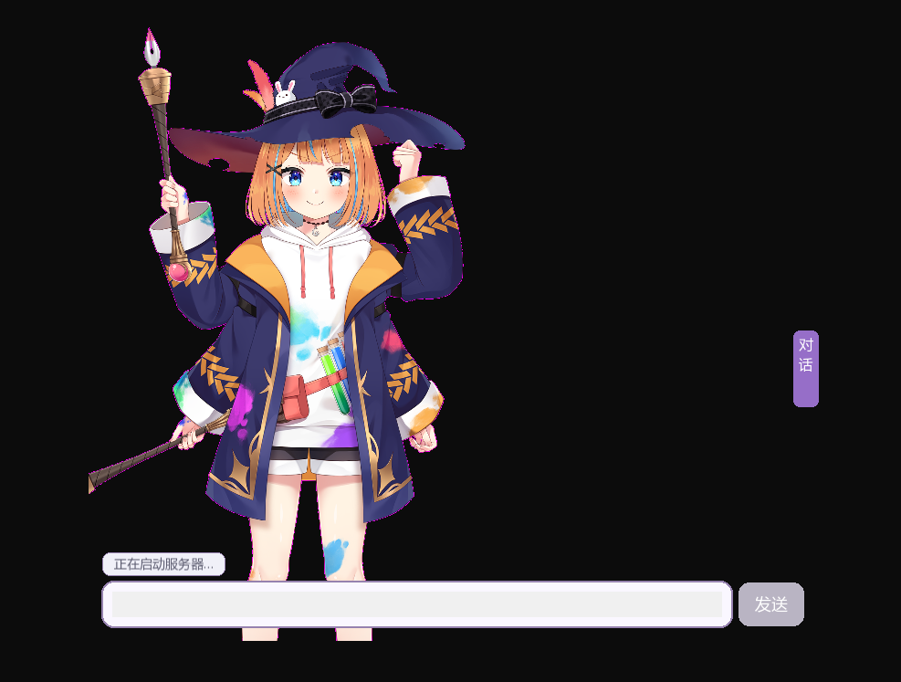
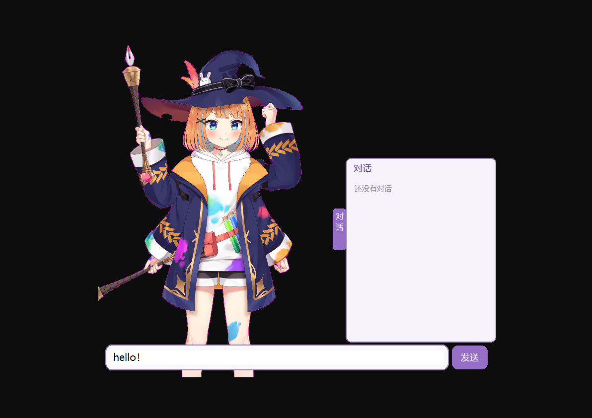
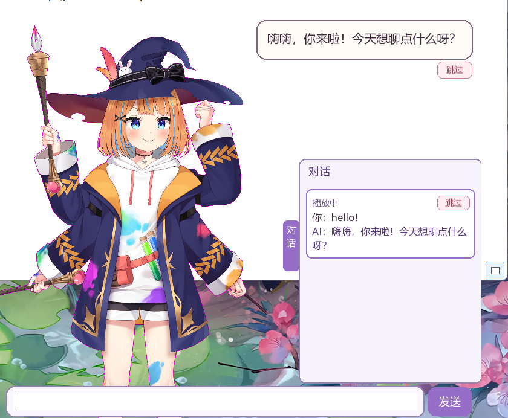

# Ratuber

[中文](#中文) | [English](#english)

---

## 中文

Ratuber 是一个用 C++ 编写的 Live2D 桌面宠物聊天机器人。它以透明、置顶的无边框窗口陪在你的桌面上：你在输入框里打字，它用 AI 回复，并用本地合成的声音"说"出来，同时根据话里的情绪做出对应的表情和动作。

### 运行截图





### 特点

- **文字聊天**：直接在窗口里输入，回复显示在气泡中，文字随语音逐字出现。
- **本地语音合成**：使用 CosyVoice2 在本机生成声音，音色可以自定义。
- **情绪驱动的表现**：回复附带情绪，行为决策服务据此从动作和表情中挑选并组合，说话时嘴型、眨眼和自然晃动同时进行。
- **排队与跳过**：回复播放期间可以继续输入，任务按顺序排队；右侧可滑出的对话面板里能取消排队中的任务，也能跳过正在播放的回复。

**技术栈**：C++20、SFML 3、Live2D Cubism SDK、DeepSeek API、CosyVoice2、FastAPI。

本项目仅用于学习和个人兴趣，不用于商业用途。

### 注意事项

1. **仅支持 Windows**：程序使用了 WinHTTP、winmm 和 Windows 自带的音频播放接口，没有做跨平台。
2. **需要 NVIDIA 显卡**：CosyVoice2 在 GPU 上运行。本项目在 RTX 3060（8 GB 显存）上开发和使用。
3. **本仓库不包含模型和 SDK**：`Ratuber/assets/` 整个目录和 Live2D Cubism SDK 都没有上传，克隆后需要按下面的"准备工作"自行下载。CosyVoice2-0.5B 的模型文件合计约 4.5 GB，请预留足够的磁盘空间。
4. **DeepSeek API 密钥**：需要自己申请，并设置环境变量 `DEEPSEEK_API_KEY`。注意：你输入的聊天文本会发送给 DeepSeek，语音合成则完全在本机完成。API 调用可能产生费用。
5. **需要修改 Python 路径**：`Ratuber/AI/AIManager.cpp` 里写着作者本机的 Python 解释器路径（`C:\Users\user\miniconda3\...`），请改成你自己的。
6. **服务端口**：语音合成服务使用 `8000` 端口，行为决策服务使用 `8001` 端口，端口被占用时会启动失败。
7. **Live2D 相关许可**：Mao 示例模型和 Cubism SDK 属于 Live2D 公司，请自行从官网下载，并遵守其许可协议。`FrameworkShaders/` 目录中的着色器来自 Live2D 官方 Framework，同样遵循 Live2D 的条款，不在本项目的 MIT 许可范围内。
8. **开发中的个人项目**：可能存在 bug，接口也可能变动，不保证长期维护。

### 准备工作

仓库只包含源码。运行前需要自行准备：

以下路径都相对于仓库根目录（也就是 `CMakeLists.txt` 所在的目录）。

1. **Live2D Cubism SDK for Native**
   - 下载地址：<https://www.live2d.com/en/sdk/download/native/>（下载前需要阅读并同意 Live2D 的许可协议）。
   - 本项目基于 `5-r.5` 版本开发。把下载得到的压缩包解压到仓库根目录，使目录名为 `CubismSdkForNative-5-r.5`，与 `CMakeLists.txt` 同级。官网提供的是最新版，如果版本不同，目录名和兼容性需要自行调整。
2. **Mao 示例模型**：Mao 包含在上一步的 SDK 里，不需要另外下载，直接复制到 `Ratuber/assets/Mao/`：

   ```powershell
   New-Item -ItemType Directory -Force Ratuber\assets | Out-Null
   Copy-Item -Recurse CubismSdkForNative-5-r.5\Samples\Resources\Mao Ratuber\assets\Mao
   ```

3. **CosyVoice 和 CosyVoice2-0.5B 模型**
   - 项目地址：<https://github.com/FunAudioLLM/CosyVoice>。在 `Ratuber/assets/` 下克隆（注意要带 `--recursive` 以拉取子模块）：

     ```powershell
     cd Ratuber\assets
     git clone --recursive https://github.com/FunAudioLLM/CosyVoice.git CosyVoice
     ```

     克隆完成后，`Ratuber/assets/CosyVoice/` 就是 CosyVoice 项目的根目录。如果子模块因网络失败，进入该目录运行 `git submodule update --init --recursive` 重试。
   - Python 环境（conda、依赖安装）请按 CosyVoice 官方 README 的说明创建，本项目使用名为 `cosyvoice` 的环境。
   - 模型：在 `Ratuber/assets/CosyVoice/` 目录下，通过 ModelScope 下载 `CosyVoice2-0.5B`：

     ```powershell
     pip install modelscope
     python -c "from modelscope import snapshot_download; snapshot_download('iic/CosyVoice2-0.5B', local_dir='pretrained_models/CosyVoice2-0.5B')"
     ```

     模型最终应位于 `Ratuber/assets/CosyVoice/pretrained_models/CosyVoice2-0.5B/`。
4. **自定义音色**：在 `Ratuber/assets/CosyVoice/` 目录下放两个文件：
   - `voice.wav`：参考音频；
   - `test.txt`：参考音频对应的文字内容。
5. **Python 环境**：行为决策服务（`Ratuber/AI/Server/ai_server.py`）和语音合成服务（`Ratuber/AI/Server/tts_server.py`）基于 FastAPI。作者用 conda 环境运行：决策服务用 base 环境，语音合成服务用名为 `cosyvoice` 的环境。
6. **DeepSeek 密钥**：设置环境变量 `DEEPSEEK_API_KEY`。

### 构建

项目使用 CMake（C++20），依赖通过 vcpkg 清单（`vcpkg.json`）管理。建议使用 Visual Studio 并安装"使用 C++ 的桌面开发"工作负载，用 Visual Studio 打开仓库根目录，让它自动完成 CMake 配置和 vcpkg 依赖安装，再生成并运行。

### 许可证

本项目自己编写的代码以 [MIT 许可证](LICENSE) 发布。第三方内容（Live2D Cubism SDK、Live2D Framework 着色器、Mao 模型、CosyVoice、nlohmann/json 等）不在其范围内，各自遵循原有许可。

---

## English

Ratuber is a Live2D desktop-pet chatbot written in C++. It lives on your desktop in a transparent, always-on-top window: you type a message, it replies with AI, speaks the answer in a locally synthesized voice, and reacts with matching expressions and motions.

### Screenshots


### Features

- **Text chat**: type directly in the window; replies appear in a speech bubble, revealed character by character in sync with the voice.
- **Local text-to-speech**: voices are generated on your own machine with CosyVoice2, with a customizable voice.
- **Emotion-driven performance**: each reply carries an emotion; a behavior service picks and combines motions and expressions from it, while lip movement, blinking and idle sway run alongside.
- **Queue and skip**: keep typing while it speaks; tasks are queued in order. A slide-out chat panel lets you cancel queued tasks or skip the reply that is playing.

**Tech stack**: C++20, SFML 3, Live2D Cubism SDK, DeepSeek API, CosyVoice2, FastAPI.

This project is for learning and personal interest only and is not intended for commercial use.

### Notes

1. **Windows only**: the app uses WinHTTP, winmm and the built-in Windows audio playback API. There is no cross-platform support.
2. **NVIDIA GPU required**: CosyVoice2 runs on the GPU. The project is developed and used on an RTX 3060 (8 GB VRAM).
3. **Models and SDKs are not included**: the whole `Ratuber/assets/` directory and the Live2D Cubism SDK are not in this repository. After cloning, download them as described in "Setup" below. The CosyVoice2-0.5B model files total about 4.5 GB, so leave enough disk space.
4. **DeepSeek API key**: you need your own key, set as the environment variable `DEEPSEEK_API_KEY`. Note that your chat text is sent to DeepSeek, while speech synthesis runs entirely on your machine. API calls may incur costs.
5. **Python paths must be edited**: `Ratuber/AI/AIManager.cpp` contains the author's local Python interpreter paths (`C:\Users\user\miniconda3\...`). Change them to your own.
6. **Service ports**: the text-to-speech service uses port `8000` and the behavior service uses port `8001`. Startup fails if a port is already in use.
7. **Live2D licensing**: the Mao sample model and the Cubism SDK belong to Live2D Inc. Download them from the official site yourself and follow their license terms. The shaders in `FrameworkShaders/` come from the official Live2D Framework; they are also covered by Live2D's terms and are not part of this project's MIT license.
8. **Work-in-progress personal project**: expect bugs and interface changes; long-term maintenance is not guaranteed.

### Setup

The repository contains source code only. Before running, prepare the following:

All paths below are relative to the repository root (the directory containing `CMakeLists.txt`).

1. **Live2D Cubism SDK for Native**
   - Download: <https://www.live2d.com/en/sdk/download/native/> (you must read and agree to Live2D's license agreements before downloading).
   - This project was developed against version `5-r.5`. Extract the downloaded archive into the repository root so the folder is named `CubismSdkForNative-5-r.5`, next to `CMakeLists.txt`. The website offers the latest version; if yours differs, the folder name and compatibility may need adjusting.
2. **Mao sample model**: Mao ships inside the SDK from the previous step, so there is nothing extra to download. Copy it to `Ratuber/assets/Mao/`:

   ```powershell
   New-Item -ItemType Directory -Force Ratuber\assets | Out-Null
   Copy-Item -Recurse CubismSdkForNative-5-r.5\Samples\Resources\Mao Ratuber\assets\Mao
   ```

3. **CosyVoice and the CosyVoice2-0.5B model**
   - Project: <https://github.com/FunAudioLLM/CosyVoice>. Clone it inside `Ratuber/assets/` (use `--recursive` to fetch the submodules):

     ```powershell
     cd Ratuber\assets
     git clone --recursive https://github.com/FunAudioLLM/CosyVoice.git CosyVoice
     ```

     Afterwards `Ratuber/assets/CosyVoice/` is the root of the CosyVoice project. If the submodules fail because of network problems, run `git submodule update --init --recursive` in that folder to retry.
   - Create the Python environment (conda, dependencies) by following the official CosyVoice README; this project uses an environment named `cosyvoice`.
   - Model: from inside `Ratuber/assets/CosyVoice/`, download `CosyVoice2-0.5B` through ModelScope:

     ```powershell
     pip install modelscope
     python -c "from modelscope import snapshot_download; snapshot_download('iic/CosyVoice2-0.5B', local_dir='pretrained_models/CosyVoice2-0.5B')"
     ```

     The model should end up in `Ratuber/assets/CosyVoice/pretrained_models/CosyVoice2-0.5B/`.
4. **Custom voice**: place two files in `Ratuber/assets/CosyVoice/`:
   - `voice.wav`: the reference audio;
   - `test.txt`: the transcript of the reference audio.
5. **Python environments**: the behavior service (`Ratuber/AI/Server/ai_server.py`) and the TTS service (`Ratuber/AI/Server/tts_server.py`) are built on FastAPI. The author runs them in conda environments: the base environment for the behavior service and an environment named `cosyvoice` for the TTS service.
6. **DeepSeek key**: set the environment variable `DEEPSEEK_API_KEY`.

### Build

The project uses CMake (C++20), with dependencies managed through a vcpkg manifest (`vcpkg.json`). Visual Studio with the "Desktop development with C++" workload is recommended: open the repository root folder in Visual Studio, let it run CMake configuration and install the vcpkg dependencies, then build and run.

### License

The code written for this project is released under the [MIT License](LICENSE). Third-party content (Live2D Cubism SDK, Live2D Framework shaders, the Mao model, CosyVoice, nlohmann/json, etc.) is not covered by it and remains under its original license.
